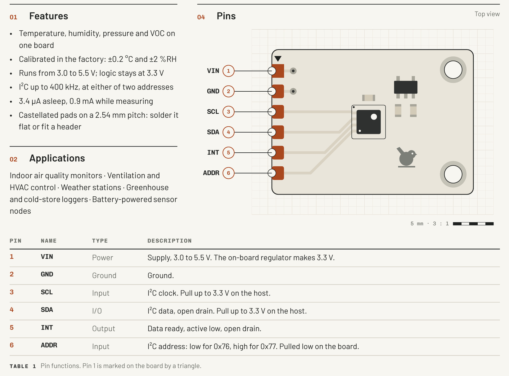
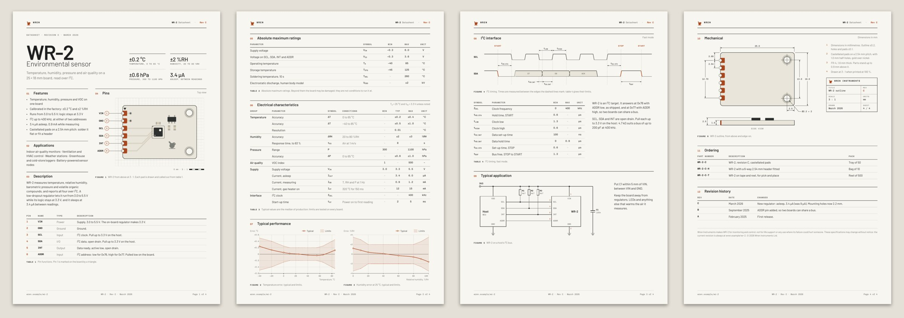
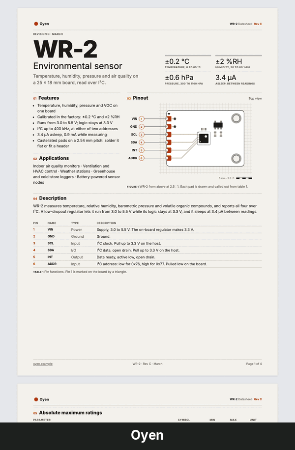
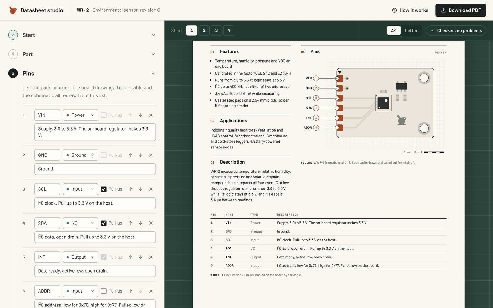
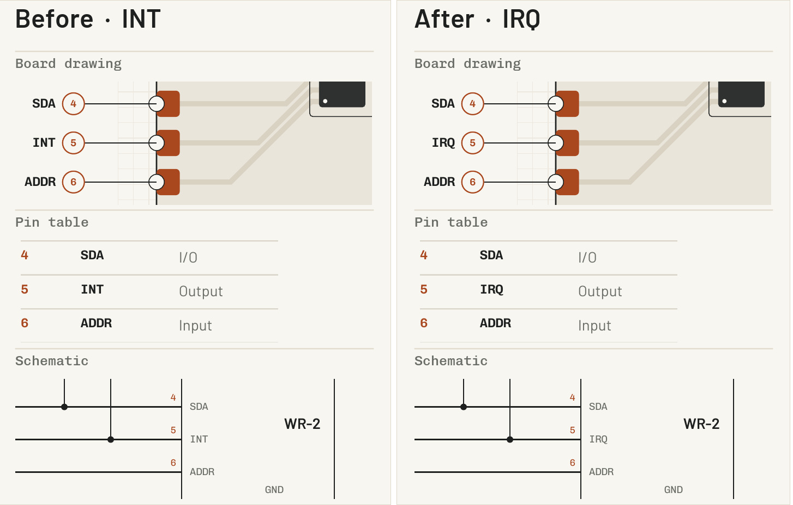
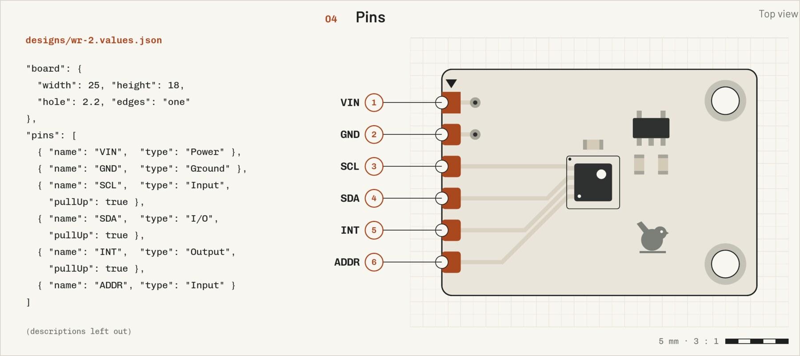
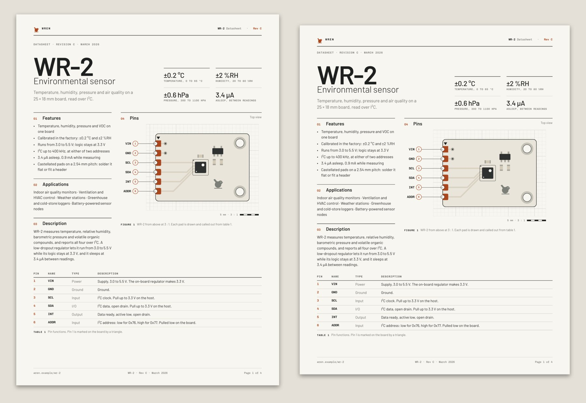
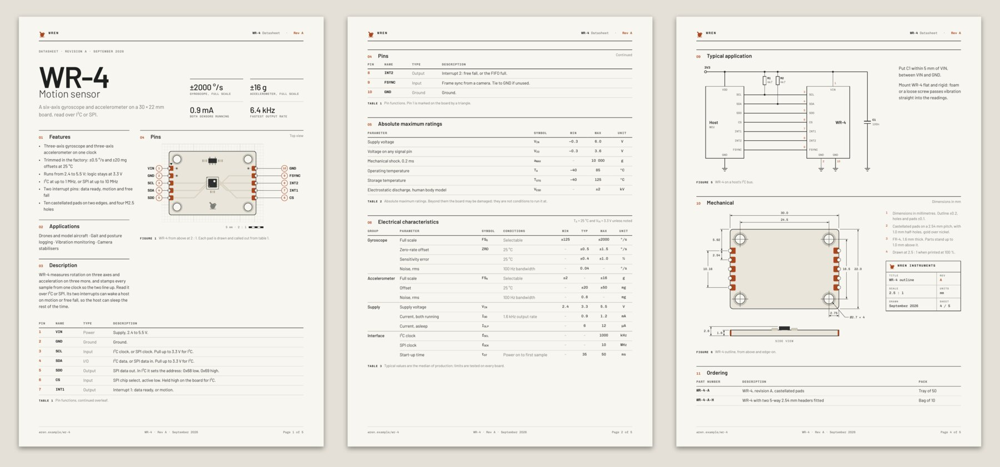
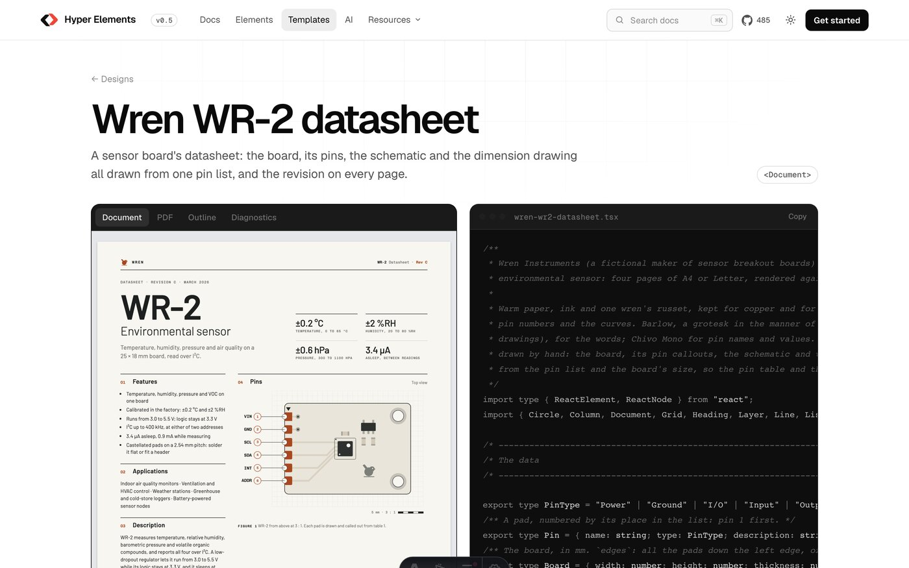

# Wren WR-2 datasheet

**A Hyper Elements template for a hardware part's datasheet: the board drawing, pin table and schematic driven by one pin list, and the part number and revision on every page.**

**[Try it live: Datasheet studio](https://hyper-elements-datasheet.vercel.app)** · [In the official templates folder, tested in all nine sample brands](#in-the-official-templates-folder-in-all-nine-sample-brands)

[](docs/page-1.jpg)

[](docs/hero.jpg)

A small hardware company publishes a datasheet for every part and every revision. Laid out by hand, the pin table and the board drawing drift apart. Here the datasheet is data: the pins, ratings, characteristics and board size are values, and every drawing is made from them. Change a pin and the board drawing, the pin table and the schematic change together. The same values render on A4 and on Letter.

## In the official templates folder, in all nine sample brands

On 23 November the Hyper Elements team rebuilt their gallery around a `templates/` folder anyone can contribute to,
where each template is made from a brand and tested in all nine sample brands. This one is ported to that format:
[`community-template/documents/datasheet/`](community-template/documents/datasheet/template.tsx) is `datasheet(brand)`, which takes every
color, font and logo from the brand it's given and sets none of its own: the board drawing in the brand's colors (its primary for the pads and signal), the timing diagram, the schematic, the outline and the tables in its fonts, its logo in every page header, and its name in the drawing's title block. Its default brand is
Oyen, the sample hardware maker, and its two designs are in `designs/`.



The gallery's own test checks the template's example and both designs against its fields and rules, and renders them,
in every brand. To run it yourself from a fresh clone of the official repository:

```
$ bash scripts/verify-in-gallery.sh
 ✓ documents/datasheet > has designs
 ✓ documents/datasheet > passes its check in casa-albero, with its example and each design
 ✓ documents/datasheet > passes its check in ember, with its example and each design
   … keel, orbit, oyen, pell-ashby, pith, quarry, slow-signals
 Tests  11 passed
```

To add it to the gallery, copy `community-template/` into the repository's `templates/`.

[All nine brands side by side](docs/ds-nine-brands.jpg)

## Try it in the browser

**[Open Datasheet studio](https://hyper-elements-datasheet.vercel.app)**: start from the WR-2 or the WR-4, change its part details,
pins, board and I²C bus in six guided steps, and watch the datasheet redraw as you type. Every change goes through
the template's own `check()`, so a value it would refuse (a board too short for its pads, pull-ups too strong for the
bus) is named at its field before anything is drawn. Download the PDF in A4 or Letter, or the values file to use
with the command line below.



The studio is a Next.js app in `app/`. Its two routes call the same template the command line uses:
`/api/check` runs `check(values, { format })` and returns the print HTML and every diagnostic with its field, and
`/api/pdf` runs `renderPdf()` on the checked design. Run it locally:

```sh
npm ci
npm run studio        # http://localhost:3000
```

## Use it

You need Node and npm, and `pdftoppm` from Poppler on your PATH for the page PNGs. The build fetches the fonts from Google Fonts on its first run.

```sh
git clone https://github.com/adityasarade/hyper-elements-datasheet
cd hyper-elements-datasheet
npm ci
npm run build
```

`out/wren-wr2-datasheet.pdf` is the gallery design, with every page as a PNG. `out/designs/` holds each values file in `designs/` as an A4 PDF and a Letter PDF.

The component renders WR-2 with no props. Pass a part's data and a paper size to render your own.

```tsx
import WrenWr2Datasheet, { WR2 } from "./src/wren-wr2-datasheet";

const letter = <WrenWr2Datasheet {...WR2} size="Letter" />;
```

To make another part, start from a values file. In this example, the CLI updates the pull-up calculation for a bus with 80 pF per line. The build draws both paper formats.

```sh
npx hyper-elements describe templates/datasheet.tsx
cp designs/wr-4.values.json designs/my-part.values.json
npx hyper-elements design set designs/my-part.values.json i2c.busCapacitancePf=80
npx hyper-elements check designs/my-part.values.json
npm run build -- designs/my-part.values.json
```

## Change a pin

Rename pin 5 from `INT` to `IRQ` in a copy of the WR-2 values. The board callout, pin table and schematic all pick up the new name.

```sh
mkdir -p out
cp designs/wr-2.values.json out/pin-demo.values.json
npx hyper-elements design set out/pin-demo.values.json 'pins[4].name=IRQ'
npm run build -- out/pin-demo.values.json
```



## How Hyper Elements is used

**The root.** A `Document` with a `PageHeader` (the Wren mark, the part number and its revision) and a `PageFooter` (`wren.example/wr-2`, and `Page <PageNumber /> of <PageNumber total />`). Barlow and Chivo Mono come in through the root's `fonts`.

**Drawings.** Every figure is an `Svg` of `Rect`, `Circle`, `Line`, `Polygon` and `Path`, computed from the data. An `Svg` holds no text, so each drawing is a `Layer`: the `Svg` first, then each label as a `Text` placed over it at the point it labels.

- **The board** (figure 1) is drawn from the pin list and the board's size: castellated pads on a 2.54 mm pitch, the mounting holes, a trace from each signal pad to the sensor, and a via on each power and ground pad. Each pad gets a numbered callout. Where the pads are too close for their callouts, the callouts fan out on bent leaders. The parts go where the family's layout puts them, but only where they fit, so a small board shows fewer parts instead of overlapping ones. The drawing uses the largest standard scale that fits (5:1 to 1:2) and is true to scale when printed at 100%.
- **The charts** (figures 2 and 3) draw a typical-error curve through the measured points (monotone cubic, so it never overshoots a point), the limits as a band, and ticks picked from the data.
- **The I²C timing diagram** (figure 4) is drawn from SCL and SDA as lists of high, low and data segments. Table 4 holds the I²C specification's limits for the bus mode the values name.
- **The schematic** (figure 5) wires power pins to 3V3, ground pins to ground, and signals to the host. Each signal marked `pullUp` gets a resistor labelled from `i2c.pullUpOhms`.
- **The dimension drawing** (figure 6) has a plan with chained dimensions for the pads, the holes and the outline, a side view with the thickness, and a title block.

```ts
// Each signal pad's trace: in from the pad, a 45-degree turn, then under the sensor (from drawBoard).
const run = Math.abs(ty - p.y);
const knee = land - dir * (0.7 + run);
const bend = dir > 0 ? Math.max(PAD_DEEP + 0.5, knee) : Math.min(W - PAD_DEEP - 0.5, knee);
pen.polyline([[X(edge + dir * (PAD_DEEP - 0.3)), Y(p.y)], [X(bend), Y(p.y)], [X(land - dir * 0.7), Y(ty)], [X(land), Y(ty)]], TRACE, 0.34 * s);
```

**Pages.** A PDF's content doesn't flow from one page to the next, so each part of the datasheet works out its own height from its data. Tables and drawings know theirs exactly; text is estimated from its length. The parts are then laid onto `Document.Page`s in order. A part that doesn't fit starts the next page. A table that doesn't fit breaks between rows and repeats its header under a "Continued" heading. WR-2 fits on four pages. WR-4 has ten pins and longer lists, so it runs to a fifth.

**The template.** [`templates/datasheet.tsx`](templates/datasheet.tsx) is `wren.Datasheet`, with `a4` and `letter` formats and WR-2 as its example. It accepts 2 to 12 pins and checks that the board is tall enough for them. It requires unique x-values and a plottable, nonzero curve or band, and checks the cover revision against the latest dated entry in the revision history. `characteristicsNote` sets the note under the electrical characteristics table.

**Pull-up sizing.** The interface note calculates the estimated rise time as `0.8473 × resistance × capacitance` and the template checks it against the limit for the chosen mode. WR-2 uses 2.2 kΩ at 100 pF per line, about 186 ns against the 300 ns Fast-mode limit. WR-4 uses 1 kΩ at 100 pF per line, about 84.7 ns against the 120 ns Fast-mode Plus limit. [NXP UM10204, Table 10 and §7.1](https://www.nxp.com/docs/en/user-guide/UM10204.pdf)

For example, a board too short for its pads gives this error.

```text
error template/render: 6 pads on a 2.54 mm pitch need an edge of at least 15.2 mm; the board is 12 mm tall.
Make it taller, or put the pads along two edges.
```

```ts
rules: {
  require: { core: ["layout/overflow", "document/overflow"] },
  root: { lang: true, title: true },
},
```

## Views

Each A4 page of WR-2: [overview](docs/page-1.jpg), [electrical](docs/page-2.jpg), [interface](docs/page-3.jpg), [mechanical](docs/page-4.jpg).

The board drawing beside the values that drew it:



The same values on A4 and on Letter. The text width and the room on each page follow the paper:



WR-4, a motion sensor made from the same template: ten pads on two edges, four holes, the pin table continued on page 2, a schematic with seven signals, and its own dimension drawing:



## Checks

```text
$ npm run build
✓ src/wren-wr2-datasheet.tsx (Document): 0 errors and warnings, 0 notes
✓ designs/wr-2.values.json [a4] → out/designs/wr-2.a4.pdf: 0 errors and warnings, 0 notes
✓ designs/wr-2.values.json [letter] → out/designs/wr-2.letter.pdf: 0 errors and warnings, 0 notes
✓ designs/wr-4.values.json [a4] → out/designs/wr-4.a4.pdf: 0 errors and warnings, 0 notes
✓ designs/wr-4.values.json [letter] → out/designs/wr-4.letter.pdf: 0 errors and warnings, 0 notes

$ npx hyper-elements check src templates designs
✓ src/wren-wr2-datasheet.tsx (Document)
✓ templates/datasheet.tsx (Document)
✓ designs/wr-2.values.json [a4] (Document)
✓ designs/wr-2.values.json [letter] (Document)
✓ designs/wr-4.values.json [a4] (Document)
✓ designs/wr-4.values.json [letter] (Document)
6 designs: 0 errors, 0 warnings, 0 skipped
```

`npx tsc --noEmit` passes. Two notes on the build:

- The CLI can't draw a Document's PDF in this setup, so `scripts/build.tsx` and `scripts/render-design.tsx` call `renderPdf()` directly. The second one reads each values file, checks it with the template, and draws the checked snapshot.
- react-pdf hyphenates English by default. Both scripts turn that off with `Font.registerHyphenationCallback((word) => [word])`, so the narrow columns break between whole words.

## Add it to the gallery

Copy [`src/wren-wr2-datasheet.tsx`](src/wren-wr2-datasheet.tsx) to `apps/website/examples/templates/`. It has the gallery's `meta` and renders with no props.

This screenshot shows an earlier local gallery build at `/templates/wren-wr2-datasheet`, made with the site's own generator (`pnpm generate`) and dev server.



## License

MIT, see [LICENSE](LICENSE). Barlow and Chivo Mono are from Google Fonts, under the SIL Open Font License.
